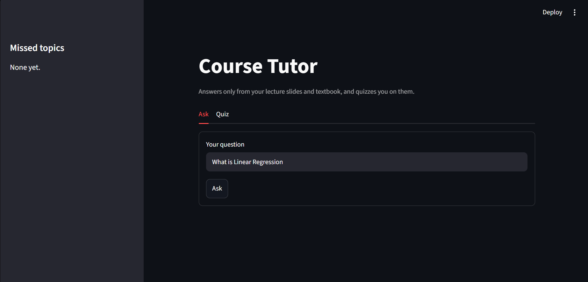
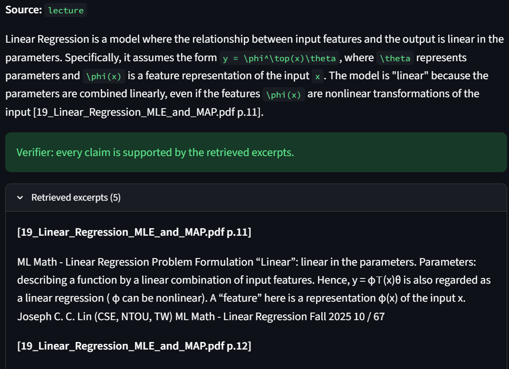
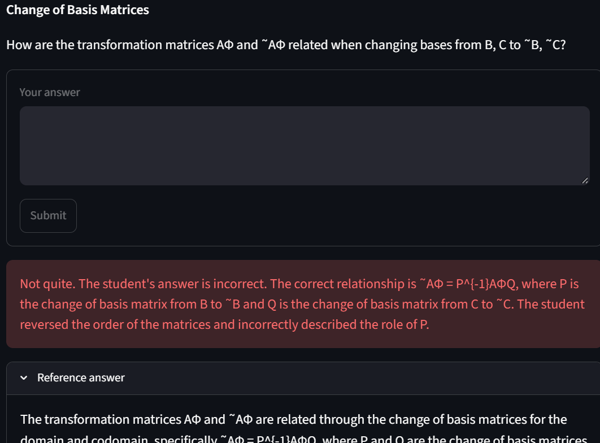
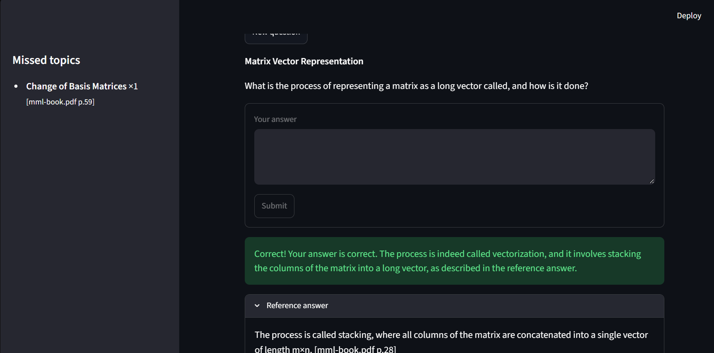
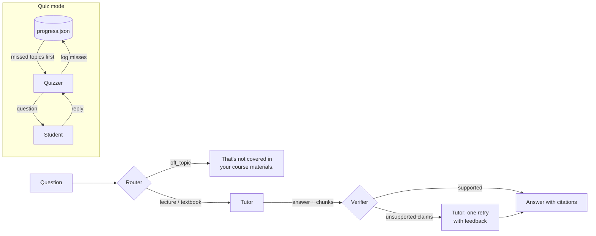

# Course Tutor: Multi-Agent RAG

A tutor for a *Mathematics for Machine Learning* course that answers **only** from the course's lecture slides
and textbook, cites the page every claim comes from, checks its own answers, and quizzes you on the material,
coming back to the topics you missed.

## Screenshots

**1. Ask tab.** Type a question about the course. The sidebar tracks topics you've missed in quizzes.



**2. A verified answer.** The Router sent "What is Linear Regression" to the lecture slides. The Tutor answered
from the retrieved excerpts with a page citation (`[19_Linear_Regression_MLE_and_MAP.pdf p.11]`), and the Verifier
confirmed every claim is supported. The excerpts the answer was built from can be opened underneath.



**3. Quiz: a wrong answer.** The Quizzer wrote a question on change-of-basis matrices from a textbook chunk, graded
the reply as incorrect, explained the right relationship, and offers the reference answer. The topic is logged
to `progress.json` as missed.



**4. Quiz: a correct answer, with missed topics tracked.** A question on representing a matrix as a vector is
graded correct, with the reference answer and its citation (`[mml-book.pdf p.28]`). The sidebar now lists
"Change of Basis Matrices" from screenshot 3, which the next quiz will review first.



## How it works

Four agents, each a single call to a local open-weight model (`qwen3:8b` via Ollama, no API key), over one Chroma collection:



| Agent | What it does |
|---|---|
| **Router** | Classifies the question as `lecture`, `textbook` or `off_topic`. This doubles as the relevance check: off-topic questions get a fixed fail-safe reply and never reach retrieval. |
| **Tutor** | Vector search filtered to the routed source (`where={"source": route}`), top 5 chunks, then answers from those chunks only with `[file p.N]` citations. |
| **Verifier** | Checks every claim in the answer against the same chunks. If any claim is unsupported, the Tutor gets **one** retry with the list of bad claims. It never loops. |
| **Quizzer** | Writes a question from a course chunk, grades your reply against that chunk, and logs missed topics to `progress.json`. The next quiz reviews missed topics first; a correct review clears it. |

**Kept simple on purpose:** plain vector search (Chroma default embeddings, no BM25/hybrid), one collection
tagged by `source`, progress in a JSON file, and 15 hand-written test questions instead of an eval suite.

## The Verifier catching an error

`tests/check_verifier.py` feeds the Verifier a deliberately wrong answer about the course's grading policy.
The slide it cites (`01_Course_Introduction.pdf p.3`) actually says: *Attendance 10%, Assignments & Quizzes 30%,
Midterm 30%, Final 30%.*

**Before** (forced wrong answer):

> The final exam is worth 50% and the midterm 20%, with a group project making up the remaining 30%
> [01_Course_Introduction.pdf p.3]. Attendance is not graded.

**Verifier output and the Tutor's retry:**

```text
TODO: paste the output of `python -m tests.check_verifier` here
```

## Setup

```bash
pip install -r requirements.txt
ollama pull qwen3:8b             # install Ollama first: https://ollama.com/download
```

Put PDFs in `data/lecture/` and `data/textbook/`, then build the vector store (rebuilds from scratch each run):

```bash
python -m tutor.ingest
```

## Usage

```bash
streamlit run app.py                         # web UI: Ask and Quiz tabs
python -m tutor.tutor "What is an eigenvector?"   # one question from the terminal
python -m tutor.quizzer [topic]              # quiz loop in the terminal
```

## Tests

```bash
python -m tests.run_questions --route   # routing accuracy on the 15 test questions
python -m tests.run_questions           # full pipeline with answers
python -m tests.check_verifier          # forced wrong answer must be caught and fixed
python -m tests.check_quizzer           # progress.json logic (no API calls)
```

## Layout

```
data/lecture/*.pdf      lecture slides          tutor/router.py     Router agent
data/textbook/*.pdf     textbook                tutor/tutor.py      Tutor agent + ask() pipeline
tutor/config.py         paths, model, chunking  tutor/verifier.py   Verifier agent
tutor/ingest.py         PDF -> chunks -> Chroma tutor/quizzer.py    Quizzer agent
tutor/llm.py            shared LLM call         app.py              Streamlit UI
tests/                  test questions and checks
```

Note: citation page numbers are PDF page positions, which for the textbook differ from its printed page numbers.
