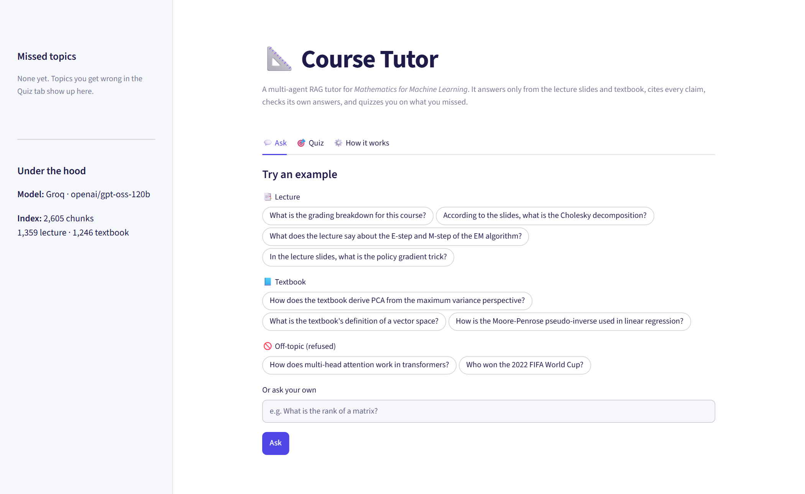
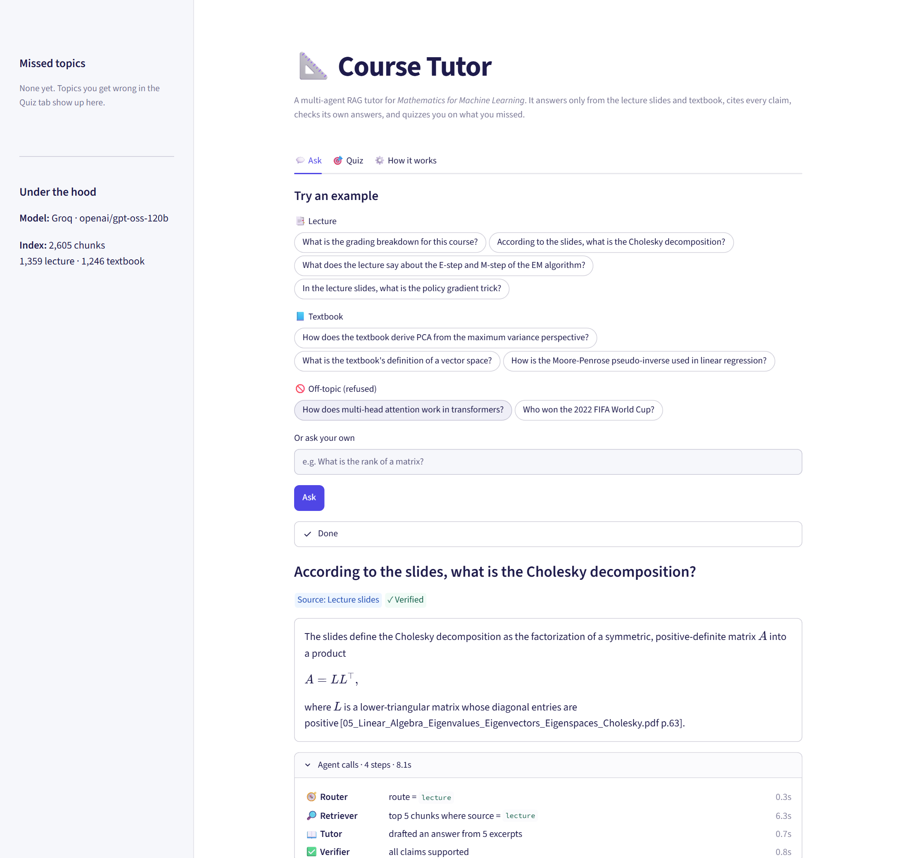
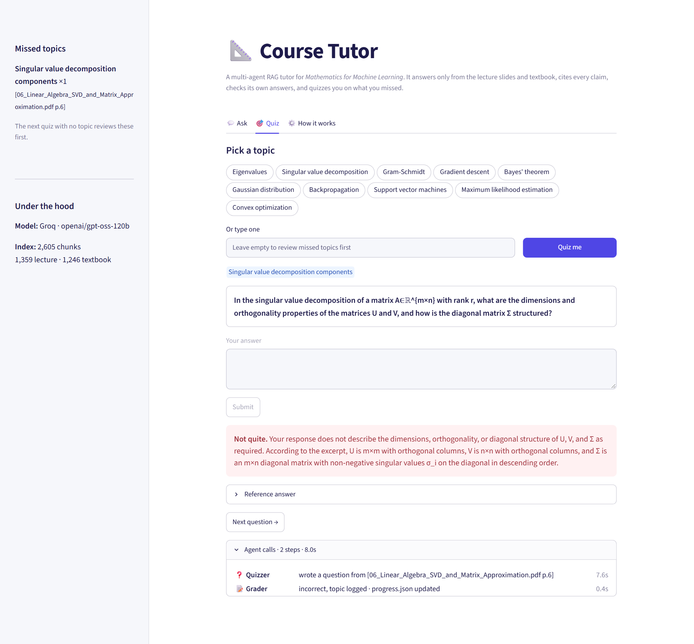
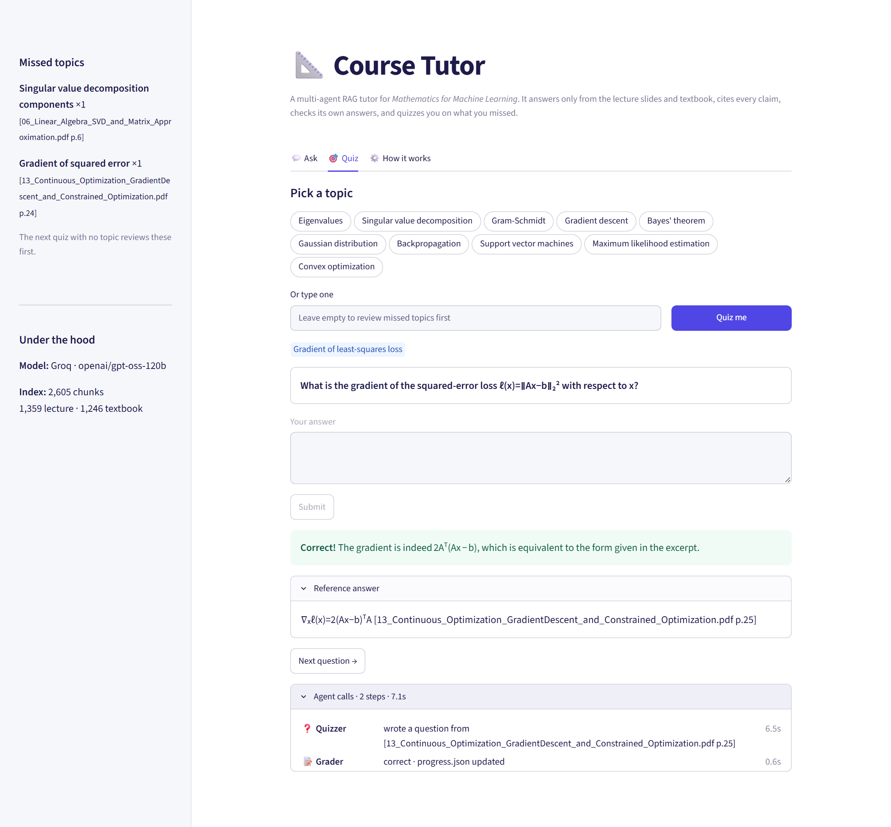
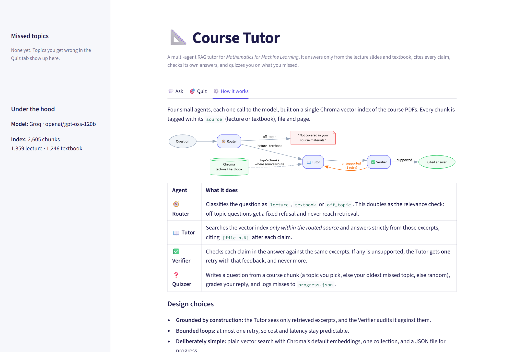
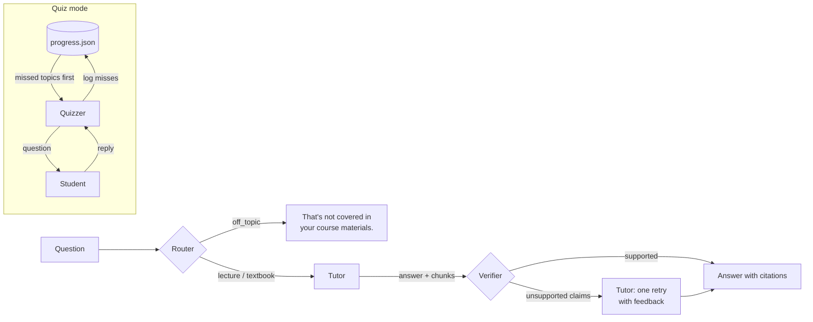

# Course Tutor: Multi-Agent RAG

A tutor for a *Mathematics for Machine Learning* course that answers **only** from the course's lecture slides
and textbook, cites the page every claim comes from, checks its own answers, and quizzes you on the material,
coming back to the topics you missed.

**Live demo:** https://course-tutor.onrender.com (free Render instance; the first load after it's been idle takes about a minute)

## Screenshots

**1. Ask tab.** Click an example question (lecture, textbook, or off-topic to see the refusal) or type your own.
The sidebar shows topics you've missed in quizzes, the model in use, and the size of the index.



**2. A verified answer, with the agent calls.** The Router sent the Cholesky question to the lecture slides, the
Retriever pulled the top 5 lecture chunks, the Tutor answered with a page citation
(`[05_Linear_Algebra_Eigenvalues_Eigenvectors_Eigenspaces_Cholesky.pdf p.63]`), and the Verifier confirmed every
claim. The *Agent calls* panel lists each step and its time. Steps appear live while the question runs.



**3. Quiz: a wrong answer.** Pick a topic. The Quizzer writes a question from a matching course chunk, the Grader
marks the reply incorrect and explains the right answer, and the topic is logged to `progress.json` (see the
sidebar).



**4. Quiz: a correct answer.** A gradient-descent question graded correct, with the reference answer and its
citation. The missed topics in the sidebar are what the next quiz with no topic reviews first.



**5. How it works.** A diagram of the flow between the agents, what each agent does, and the design choices,
inside the app.



## How it works

Four agents, each a single call to a local open-weight model (`qwen3:8b` via Ollama, no API key), over one Chroma collection:



| Agent | What it does |
|---|---|
| **Router** | Classifies the question as `lecture`, `textbook` or `off_topic`. This doubles as the relevance check: off-topic questions get a fixed fail-safe reply and never reach retrieval. |
| **Tutor** | Vector search filtered to the routed source (`where={"source": route}`), top 5 chunks, then answers from those chunks only with `[file p.N]` citations. |
| **Verifier** | Checks every claim in the answer against the same chunks. If any claim is unsupported, the Tutor gets **one** retry with the list of bad claims. It never loops. |
| **Quizzer** | Writes a question from a course chunk, grades your reply against that chunk, and logs missed topics to `progress.json`. The next quiz reviews missed topics first; a correct review clears it. |

**Kept simple on purpose:** plain vector search (Chroma default embeddings, no BM25/hybrid), one collection
tagged by `source`, progress in a JSON file, and 15 hand-written test questions instead of an eval suite.

## The Verifier catching an error

`tests/check_verifier.py` feeds the Verifier a deliberately wrong answer about the course's grading policy.
The slide it cites (`01_Course_Introduction.pdf p.3`) actually says: *Attendance 10%, Assignments & Quizzes 30%,
Midterm 30%, Final 30%.*

**Before** (forced wrong answer):

> The final exam is worth 50% and the midterm 20%, with a group project making up the remaining 30%
> [01_Course_Introduction.pdf p.3]. Attendance is not graded.

**Verifier output and the Tutor's retry:**

```text
TODO: paste the output of `python -m tests.check_verifier` here
```

## Setup

```bash
pip install -r requirements.txt
ollama pull qwen3:8b             # install Ollama first: https://ollama.com/download
```

Put PDFs in `data/lecture/` and `data/textbook/`, then build the vector store (rebuilds from scratch each run):

```bash
python -m tutor.ingest
```

## Usage

```bash
streamlit run app.py                         # web UI: Ask and Quiz tabs
python -m tutor.tutor "What is an eigenvector?"   # one question from the terminal
python -m tutor.quizzer [topic]              # quiz loop in the terminal
```

## Deploy (Render)

Render has no GPU, so the deployed app uses a hosted model on Groq's free tier (`openai/gpt-oss-120b`) instead of Ollama.
`tutor/llm.py` switches to Groq whenever `GROQ_API_KEY` is set, and falls back to Ollama when it isn't.

The `Dockerfile` installs dependencies and runs `python -m tutor.ingest` during the build, so the Chroma store and its
embedding model ship inside the image. `render.yaml` defines a free-plan Docker web service; set `GROQ_API_KEY` in the
Render dashboard. It's live at https://course-tutor.onrender.com. On the free plan the service sleeps when idle, and `progress.json` resets on each restart.

## Tests

```bash
python -m tests.run_questions --route   # routing accuracy on the 15 test questions
python -m tests.run_questions           # full pipeline with answers
python -m tests.check_verifier          # forced wrong answer must be caught and fixed
python -m tests.check_quizzer           # progress.json logic (no API calls)
```

## Layout

```
data/lecture/*.pdf      lecture slides          tutor/router.py     Router agent
data/textbook/*.pdf     textbook                tutor/tutor.py      Tutor agent + ask() pipeline
tutor/config.py         paths, model, chunking  tutor/verifier.py   Verifier agent
tutor/ingest.py         PDF -> chunks -> Chroma tutor/quizzer.py    Quizzer agent
tutor/llm.py            shared LLM call         app.py              Streamlit UI
Dockerfile, render.yaml Render deployment
tests/                  test questions and checks
```

Note: citation page numbers are PDF page positions, which for the textbook differ from its printed page numbers.
